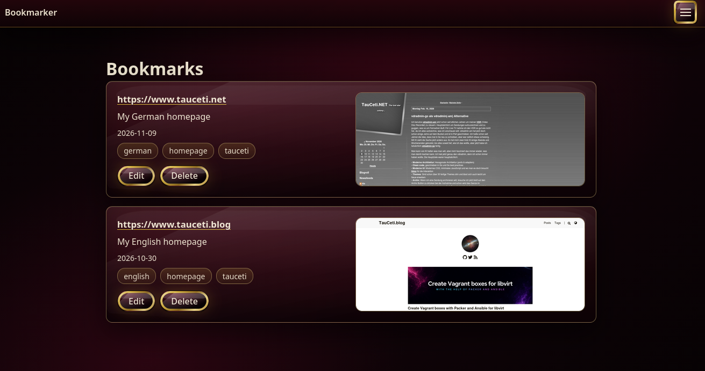

# la-memoria

Bookmarker is a Go library and server-rendered web/JSON Lines application for public bookmark browsing and authenticated administration.

__At the current state it's not really usable and buggy. Expect a lot of breaking changes till version 1.0.0!__

It's  basically a prove of concept (PoC) for getting started with [Github's Spec Kit](https://github.com/github/spec-kit) and [Spec-Driven Development (SDD)](https://github.com/github/spec-kit#-what-is-spec-driven-development).

Here is my blog post about my experience: [Spec-Driven Development with Spec Kit](https://www.tauceti.blog/posts/spec-driven-development-with-spec-kit/). I'll extend the blog post while working on this bookmark application.

## Sample Screenshot

Bookmarker with the Luxury theme and sample bookmarks:



## Setup

For a direct installation, install Go 1.27, Node.js LTS, and a PostgreSQL server. Install the Go dependencies and [agent-browser](https://github.com/vercel-labs/agent-browser) for bookmark screenshot capture:

```sh
go mod download
npm install --global agent-browser@0.35.2
agent-browser install
```

Create the deployment configuration from `config.example.yaml`, set owner-only
permissions, and provide the referenced database password through the
environment:

```sh
cp config.example.yaml config.yaml
chmod 0600 config.yaml
export BOOKMARKER_DB_PASSWORD='replace-this-value'
export BOOKMARKER_CONFIG="$PWD/config.yaml"
```

Provision the PostgreSQL database and user, then edit `config.yaml` to match their connection details and TLS configuration. Set `screenshots.root` to a directory the application user can create and write to.

`config.yaml` is intentionally ignored by Git. Startup rejects a configuration file with any group or other permission bit. Keep the administrator password verifier in deployment configuration, never plaintext. Generate a verifier by running the following command, which prompts for the administrator password without echoing it and prints a salted Argon2id PHC verifier:

```sh
go run ./cmd/bookmarker-hash
```

Set `administrator.password_hash` in `config.yaml` to the complete printed
verifier. To rotate the administrator password, generate a new verifier,
replace that value, and restart the application. Database passwords remain
environment values and must never be written to YAML.

To apply schema migrations using the deployment-authorized CLI process, run the following from the repository root:

```sh
BOOKMARKER_ALLOW_MIGRATIONS=true go run ./cmd/bookmarker-cli </dev/null
```

The web application also applies migrations on startup. Run it with
`go run ./cmd/bookmarker-web`. The CLI reads
versioned JSON Lines from stdin and emits exactly one JSON response per input
line on stdout; diagnostics are written only to stderr.

Bookmark lists and search results show the top of available screenshots beside
the bookmark details. Screenshots are public wherever bookmarks are public.

Back up PostgreSQL with standard `pg_dump` procedures and the configured
screenshot root together. Restore the database first, then restore screenshot
files under the configured root with their relative keys intact.

## Local Docker Compose

For a self-contained local evaluation environment, install Docker with the
Docker Compose plugin. The bundle at `deploy/compose/` builds from this source
checkout and starts Bookmarker with a private PostgreSQL service.

First generate an administrator verifier. The command prompts without echoing
the plaintext password and prints only the salted Argon2id verifier:

```sh
docker compose -f deploy/compose/docker-compose.yml run --rm bookmarker-hash
```

Copy the examples, then set `BOOKMARKER_ADMIN_USERNAME`, the printed
`BOOKMARKER_ADMIN_PASSWORD_HASH`, and a chosen non-empty
`BOOKMARKER_DB_PASSWORD` in `.env.credentials`. Values in that file are read
literally: paste the verifier as-is without quotes or escaping its dollar
signs. Do not put the plaintext administrator password in the file or share
the verifier unnecessarily. The separate `.env` contains only non-secret
Compose interpolation settings.

```sh
umask 077
cp deploy/compose/.env.example deploy/compose/.env
cp deploy/compose/.env.credentials.example deploy/compose/.env.credentials
chmod 600 deploy/compose/.env.credentials
# Edit deploy/compose/.env.credentials before starting.
docker compose -f deploy/compose/docker-compose.yml up --build --detach
```

Open `http://127.0.0.1:8080` and sign in with the chosen administrator
username and plaintext password.

```sh
docker compose -f deploy/compose/docker-compose.yml ps
```

shows PostgreSQL and Bookmarker health. Stop the environment with

```sh
docker compose -f deploy/compose/docker-compose.yml down
```

Named volumes keep bookmarks and screenshots until `down --volumes` is used.
The complete editable configuration is also stored on the owner-only
`BOOKMARKER_CONFIG_VOLUME` named volume. Do not remove it during an upgrade.
The container creates the volume directory with mode `0700` and the YAML with
mode `0600`; ensure the container's service user can own and write that volume.

`BOOKMARKER_HOST_PORT` changes only the browser port. Set
`BOOKMARKER_POSTGRES_VOLUME`, `BOOKMARKER_SCREENSHOTS_VOLUME`, and
`BOOKMARKER_CONFIG_VOLUME` to choose
deployment-specific named-volume names. PostgreSQL is intentionally not
published to the host. This bundle is for local evaluation: review credentials,
network exposure, backups, and transport security before non-local use.

To rotate Compose administrator credentials, update `BOOKMARKER_ADMIN_USERNAME` and/or
`BOOKMARKER_ADMIN_PASSWORD_HASH` in the protected `.env.credentials` and recreate
Bookmarker; other settings are retained. Direct `BOOKMARKER_CONFIG` deployments
continue to manage their own file and credentials.

## Appearance and bundled assets

Configuration includes one deployment-wide __Theme__ selection. The default, System, follows the browser's light/dark preference live; selecting a bundled theme applies it after the save redirect and to other visitors on their next full page load. An unavailable saved theme displays as System but is not silently replaced: select an available theme to save any configuration change.

Bookmarker uses [Chroma UI v0.3.0](https://github.com/githubixx/chroma-ui/tree/v0.3.0). Chroma is extracted from [vdradmin-go](https://github.com/githubixx/vdradmin-go); bundled themes retain their metadata and attribution. Shared CSS and navigation originate in that project; CRT WebP images derive from its generated artwork. Optional remote font imports are blocked by the application; local/system font fallbacks remain usable.

## Validation

Install the JavaScript test dependencies and Playwright browsers:

```sh
npm ci
npx playwright install chromium firefox
```

Integration and Playwright tests require Docker. The Playwright setup also requires PostgreSQL client tools (`psql` and `pg_isready`) and free local ports 54329, 18080, and 18081.

__Warning:__ The default Playwright setup overwrites `.e2e-config.yaml` and `.e2e-config.template.yaml`, and deletes both files and `.e2e-screenshots/` during teardown. Preserve any files in those locations before running it. Playwright also clears its configured test-results directory at startup.

```sh
go test ./...
go test -tags=contract ./tests/contract/...
go test -tags=integration ./tests/integration/...
go vet ./...
npx playwright test
```
